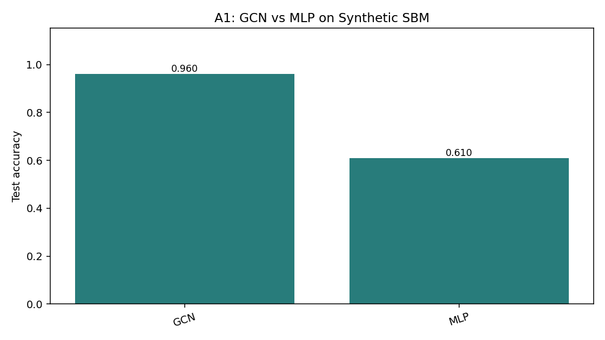
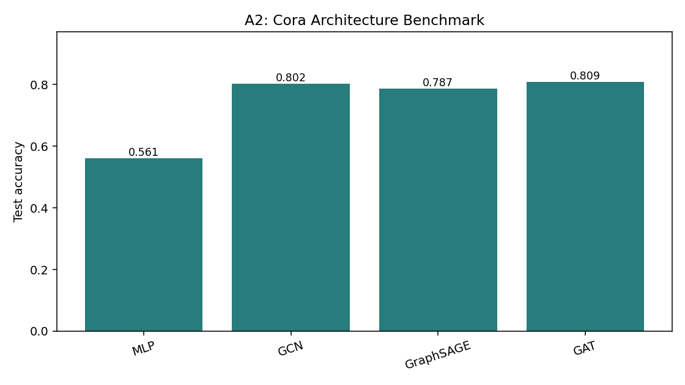
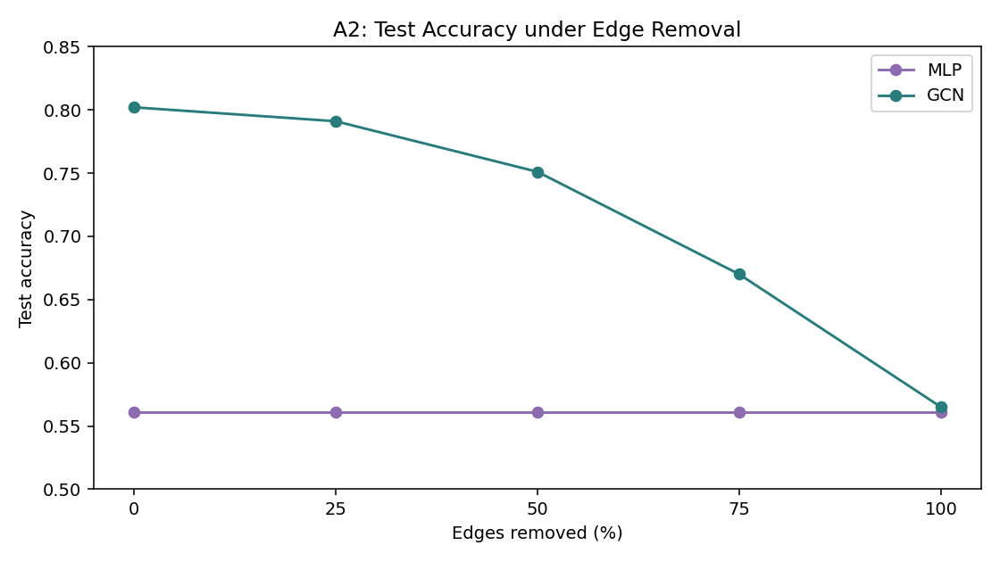
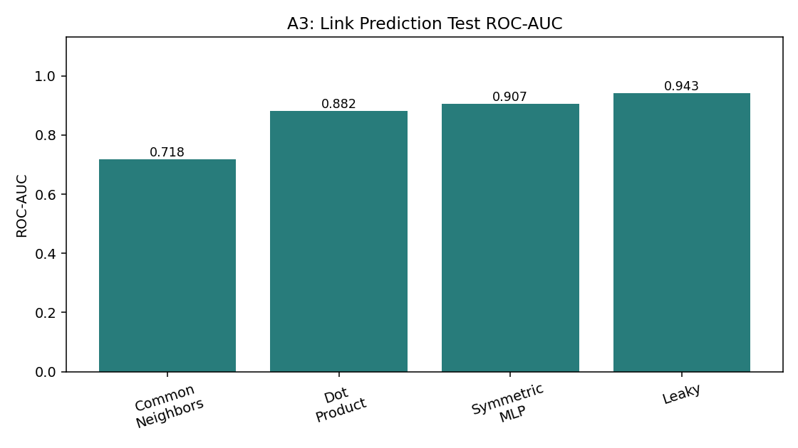
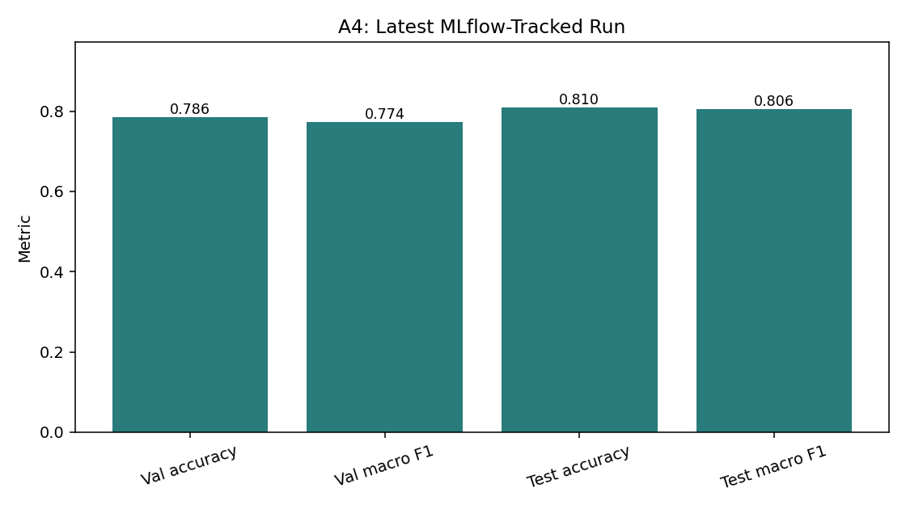

# Technical Report: GNN and MLOps Assignments

## Executive Summary

This report documents the current code-only implementation of four assignments: a from-scratch GCN, a Cora architecture benchmark, leakage-safe link prediction, and a production-oriented MLOps pipeline. The results below were obtained by running the current command-line entry points from the repository root on 2026-10-15.

The complete test suite passed with **63 passed**. Three existing dependency deprecation warnings were emitted by FastAPI, Starlette, and AnyIO; none affected correctness.

## Reproduction Commands

```bash
python -m src.a1_gcn_scratch.train
python -m src.a2_cora.train
python -m src.a2_cora.experiments
python -m src.a3_linkpred.train --config configs/a3_config.yaml --seed 42
python -m src.a4_mlops.train_tracked
python demo.py
```

The A2 experiment command initially failed because its printer requested `mean_pairwise_cosine`, while the experiment returned `mean_cosine_sim`. The CLI was corrected and rerun successfully. The measured figures are generated by `scripts/generate_report_plots.py` and stored in [reports/figures](reports/figures).

## Assignment 1: GCN from Scratch

### Method

The implementation in `src/a1_gcn_scratch` builds the renormalized GCN operation directly with PyTorch tensors. It supports dense and sparse message passing, self-loop normalization, deterministic seeding, manual node verification, permutation equivariance checks, and an MLP feature-only baseline.

The executed configuration generated a 200-node, two-class stochastic block model with three features per node, 1,962 directed edges, and edge homophily `0.8889`. The split contained 60 training, 40 validation, and 100 test nodes.

### Executed Results

| Model | Test accuracy | Test macro F1 | Best validation loss |
|---|---:|---:|---:|
| GCN from scratch | **96.00%** | **0.9600** | 0.1125 |
| MLP baseline | 61.00% | 0.6100 | 0.5469 |

The GCN's topological-context advantage was **35.00 percentage points**. The current CLI does not print train/validation accuracy or the full edge perturbation sweep, so those values are not inferred here.



### Interpretation

The large gap is consistent with the graph design: neighbors are strongly label-aligned while the features are noisy. Message passing therefore supplies useful class information that the MLP cannot recover from individual node features. The test suite additionally verifies the mathematical implementation through dense/sparse agreement, manual normalization, and permutation equivariance.

## Assignment 2: Cora Architecture Comparison

### Method

The Cora experiment compares MLP, GCN, GraphSAGE, and GAT through a shared training interface. The dataset contains 2,708 nodes, 1,433 bag-of-words features, seven classes, 10,556 directed edge entries, and the standard 140/500/1,000 train/validation/test masks.

### Architecture Benchmark

| Model | Parameters | Validation accuracy | Test accuracy | Test macro F1 | Runtime |
|---|---:|---:|---:|---:|---:|
| MLP | 92,231 | 57.80% | 56.10% | 0.5516 | 0.69 s |
| GCN | 92,231 | 77.60% | **80.20%** | 0.7945 | 0.89 s |
| GraphSAGE | 184,391 | 76.60% | 78.70% | 0.7789 | 1.87 s |
| GAT | 92,373 | 77.60% | **80.90%** | **0.7993** | 1.36 s |



The benchmark is a single-seed CLI run with a common 150-epoch maximum and early stopping. It is not a replacement for a multi-seed confidence interval.

### Depth and Edge Removal

| GCN depth | Test accuracy | Mean cosine similarity | Dirichlet energy |
|---:|---:|---:|---:|
| 1 | 73.40% | 0.0558 | 5.6991 |
| 2 | 80.20% | 0.7427 | 0.4926 |
| 4 | **81.30%** | 0.7748 | 0.3679 |
| 8 | 50.00% | 0.6805 | 0.3179 |

| Edges removed | MLP test accuracy | GCN test accuracy |
|---:|---:|---:|
| 0% | 56.10% | **80.20%** |
| 25% | 56.10% | **79.10%** |
| 50% | 56.10% | **75.10%** |
| 75% | 56.10% | **67.00%** |
| 100% | 56.10% | 56.50% |



### Interpretation

Graph structure adds 24.10 points over the feature-only MLP in the benchmark. Four layers gave the best observed depth result, while eight layers collapsed to 50.0%, consistent with excessive smoothing and optimization difficulty. Removing half the edges still left GCN 19 points above MLP; removing all edges reduced it almost to the feature-only baseline.

## Assignment 3: Link Prediction and Leakage Prevention

### Method

The link-prediction pipeline canonicalizes undirected edges as `(u, v)` with `u < v`, splits unique pairs 85/5/10, then constructs the message-passing graph from training positives only in both directions. Negative samples exclude self-links and every known positive pair. The run used 4,486 training positives, 263 validation positives, and 529 test positives, with the same counts for negatives.

Seven automated leakage and consistency checks passed, including the critical check that held-out edges and their reverse copies are absent from the message-passing graph.

### Executed Results

| Method | Test ROC-AUC | Test AP | Status |
|---|---:|---:|---|
| Common-neighbor baseline | 0.7180 | 0.7165 | Valid baseline |
| GCN plus dot-product decoder | 0.8818 | 0.8813 | Valid model |
| GCN plus symmetric MLP decoder | **0.9066** | **0.9057** | Valid model |
| Deliberately leaky dot-product model | *0.9425* | *0.9378* | Invalid |



### Interpretation

Both valid GNN models substantially outperform common neighbors. The leaky result is not a valid estimate of unseen-link performance because held-out edges remain available during message passing. The symmetric MLP decoder was strongest in this fixed-seed run, but the difference should be checked across multiple seeds before selecting it as a production default. Top-scored unobserved pairs are candidates for review, not confirmed links.

## Assignment 4: MLOps Pipeline

### Method

Assignment 4 combines seeded training, MLflow tracking, model packaging, validation gates, rollback, drift detection, and FastAPI serving. The model package contains architecture configuration, weights, feature schema, labels, metadata, and a training curve.

### Tracked Training Result

MLflow run: `8e5aed15918342a3b43c246704dabe47`

| Metric | Value |
|---|---:|
| Model | 2-layer GCN, 64 hidden channels |
| Validation accuracy | 0.7860 |
| Validation macro F1 | 0.7738 |
| Test accuracy | 0.8100 |
| Test macro F1 | 0.8064 |
| Best epoch | 11 |
| Training wall time | 1.58 s |



The run generated `model_packages/8e5aed15918342a3b43c246704dabe47/training_curve.png` locally and logged the same plot to MLflow. Model artifacts are ignored by Git and must be supplied separately in CI or deployment environments.

### End-to-End Demo Evidence

The executed `demo.py` verified all ten lifecycle requirements:

| Area | Observed result |
|---|---|
| Untracked baseline | Test accuracy 0.7790; limitations printed |
| Reload invariance | Maximum prediction difference 0.00000000 |
| Gate bootstrap | Candidate macro F1 0.82 promoted |
| Gate regression | Candidate macro F1 0.65 blocked against 0.82 |
| Gate improvement | Candidate macro F1 0.86 promoted over 0.82 |
| Rollback | Champion restored from v1.1.0 to v1.0.0 |
| API health/predict | HTTP 200 |
| API validation | Wrong dimensions, unknown targets, and bad edges returned HTTP 422 |
| Inductive serving | Unseen node prediction completed |
| Drift detection | 60% edge drop plus feature shift raised an alert |

### Interpretation

The pipeline turns a trained model into a traceable and reversible service. The promotion gate blocks regressions and missing/invalid metrics, packaging prevents architecture/schema ambiguity, and drift checks distinguish a normal snapshot from a substantially perturbed graph. The serving API requires the graph context around target nodes; partial subgraphs can change degree normalization and therefore probabilities.

## Quality and CI

The GitHub Actions workflow installs Python 3.11 dependencies, compiles `src`, `tests`, `demo.py`, and `streamlit_app.py`, runs all tests, and executes the first-model gate check. The workflow is notebook-free. Docker image builds require model artifacts because `model_packages/` is intentionally ignored; a release pipeline should download or generate those artifacts before invoking `docker build`.

## Limitations and Next Steps

- The CLI measurements above are mostly single-seed results; multi-seed confidence intervals should be generated before making deployment decisions.
- The A2 CLI currently reports depth values `[1, 2, 4, 8]`, while the YAML describes a broader sweep; the report intentionally reflects the executed CLI.
- Generated smoke-test feature vectors in the Streamlit client have the correct shape but are not substitutes for real Cora feature vectors.
- The A4 tracked model uses the local generated package; reproducible CI deployment needs an explicit model-artifact publishing step.